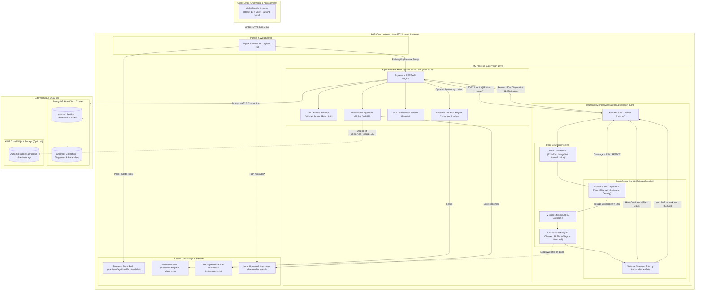
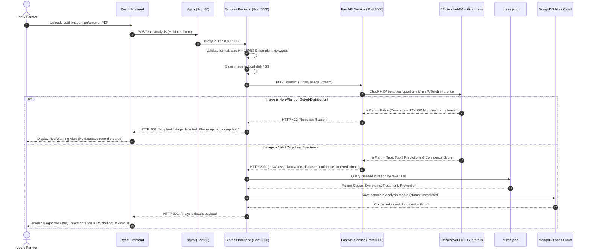

# AgriCloud-ML: End-to-End System Architecture

This document outlines the production architecture of **AgriCloud-ML: Serverless Plant Pathology & Relabeling Pipeline** deployed on **AWS EC2**, integrated with **PyTorch EfficientNet-B0**, **FastAPI**, **Express.js**, and **MongoDB Atlas Cloud**.

---

## 1. High-Level Architecture Flowchart

---

## 2. Component Breakdown

### 2.1 Ingress Tier (Nginx Reverse Proxy)
* **Port**: `80` (HTTP) / `443` (HTTPS)
* **Function**: Single entry point for all web traffic.
  * Routes root requests (`/`) directly to the pre-compiled React 18 production bundle at `/var/www/agricloud/frontend/dist`.
  * Proxies `/api/` calls to the Node.js Express backend on `http://127.0.0.1:5000/api/`.
  * Serves cached specimen images from `/uploads/` directly from disk with client max body size configured to `25M`.

### 2.2 Application Backend Tier (`agricloud-backend`)
* **Technology**: Node.js 20 LTS + Express.js
* **Process Manager**: Supervised by PM2 as `agricloud-backend`
* **Port**: `5000` (Internal)
* **Key Responsibilities**:
  1. **Authentication & Authorization**: Strict user data isolation via stateless JWT tokens and bcrypt password hashing.
  2. **Multi-Modal Document Processing**: Accepts standard JPEG/PNG imagery and clinical multi-page agronomy PDF reports (extracting specimen images via `pdf-lib`).
  3. **Non-Plant Pattern Filter**: First-pass regular expression filter that catches uploaded files depicting non-botanical objects (cars, portraits, electronics, furniture).
  4. **Dynamic Botanical Curation Service**: Integrates with `data/cures.json` to retrieve Cause, Symptoms, Treatment, and Prevention independently of ML weights.
  5. **Continuous Learning / Relabeling Loop**: Stores human-in-the-loop annotations (`Pending`, `Confirmed`, `Corrected`) and exports standard training datasets in COCO JSON and CSV formats.

### 2.3 Machine Learning Inference Tier (`agricloud-ml`)
* **Technology**: Python 3.12 + FastAPI + PyTorch + TorchVision
* **Process Manager**: Supervised by PM2 as `agricloud-ml`
* **Port**: `8000` (Internal)
* **Neural Backbone**: **EfficientNet-B0** ($224 \times 224$ input, ImageNet normalized).
* **Weights**: Fine-tuned checkpoint loaded from `model/model.pth` (99.56% validation accuracy).
* **Multi-Stage Plant Verification & OOD Guardrail**:
  1. **Botanical Spectrum Pre-Filter**: Evaluates pixel density in HSV color space across chlorophyll greens ($H: 50^\circ\text{--}155^\circ$), chlorotic yellows ($H: 28^\circ\text{--}50^\circ$), and necrotic lesion browns ($H: 14^\circ\text{--}28^\circ$). Rejects images with $< 12\%$ botanical foliage.
  2. **Dedicated Out-Of-Distribution Neural Class**: The classifier head outputs **39 classes** (38 PlantVillage categories across 14 crops + `Non_leaf_or_unknown`). When an artificial object or non-leaf image is processed, the network predicts `Non_leaf_or_unknown` and rejects it.
  3. **Shannon Entropy Gate**: Computes prediction entropy $H = -\sum p_i \ln(p_i)$. Unusually flat probability distributions trigger an Out-Of-Distribution rejection with HTTP 422.

### 2.4 Cloud Database Tier (MongoDB Atlas)
* **Cluster**: `cluster0.kjeyc9a.mongodb.net`
* **Database**: `agricloud_ml`
* **Collections**:
  * `users`: Stores user identity, hashed passwords, roles (`user`, `expert`, `admin`), and timestamps.
  * `analyses`: Stores complete pathology records, confidence metrics, top-3 alternate predictions, agronomic recommendations, review statuses, and file URLs.
* **Failover Engine**: If connection to the cloud cluster is interrupted, the backend automatically proxies requests through `backend/config/localStore.js` to `backend/data/local_db.json` with zero service disruption.

---

## 3. Data Flow Sequence

---

## 4. Port & Security Summary

| Service | Port | Access Scope | Managed By | Purpose |
| :--- | :--- | :--- | :--- | :--- |
| **Nginx** | `80` (HTTP) | Public (`0.0.0.0/0`) | `systemd` | SSL termination & reverse proxy |
| **Frontend** | Static Files | Internal | Nginx | Serves React Single Page Application |
| **Backend** | `5000` | Loopback (`127.0.0.1`) | PM2 (`agricloud-backend`) | REST API, auth, business logic |
| **ML Engine** | `8000` | Loopback (`127.0.0.1`) | PM2 (`agricloud-ml`) | PyTorch EfficientNet-B0 inference |
| **MongoDB Atlas**| `27017` (TLS) | Outbound to Atlas Cloud | Cloud Provider | User & Analysis data persistence |
| **SSH** | `22` | Admin IP / Restrictive | `sshd` | Remote server administration |
